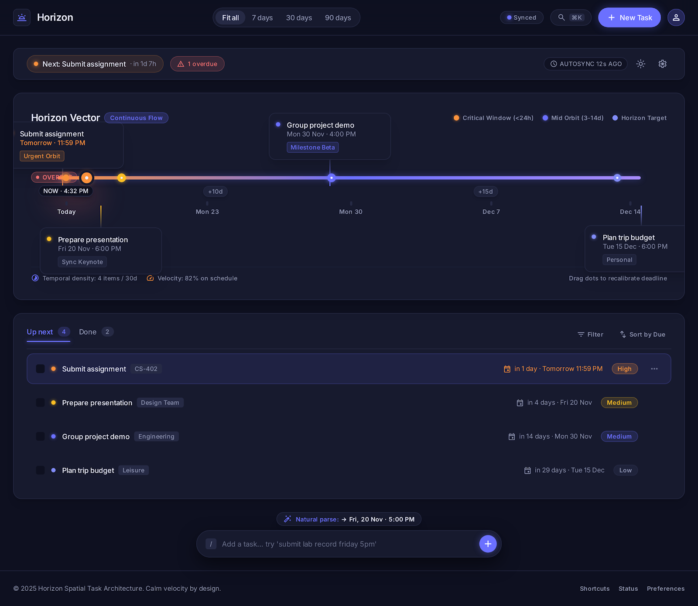
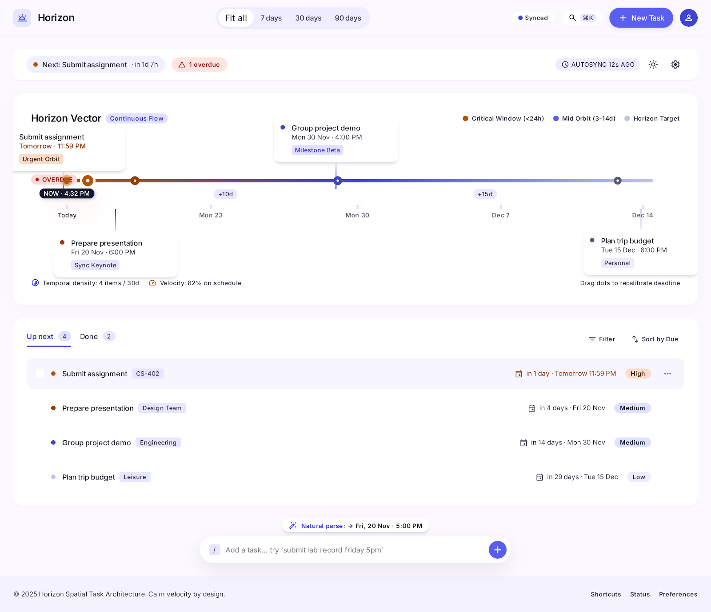
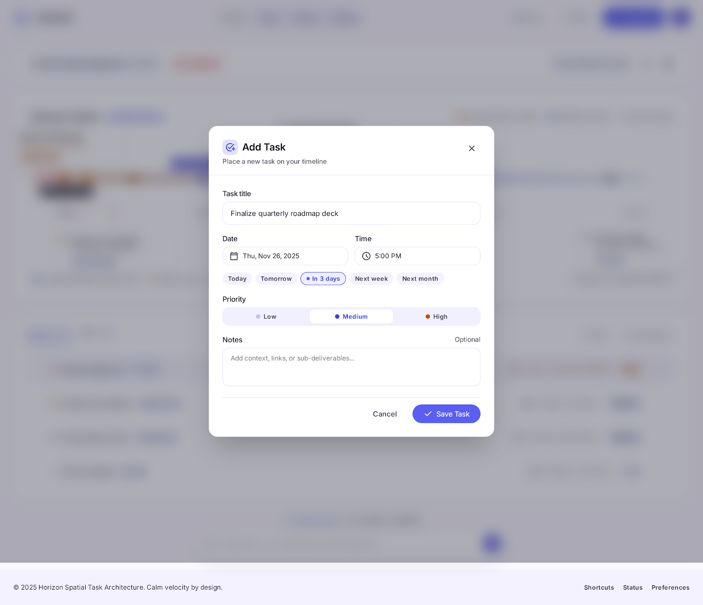
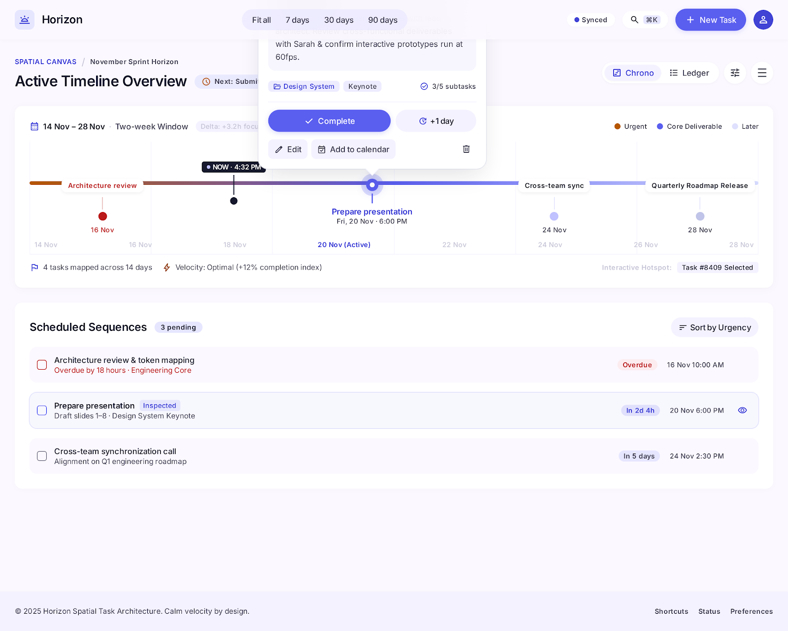

<div align="center">

  

  # HORIZON
  ### *A Continuous Proportional Timeline To-Do App*

  [](https://nodejs.org/)
  [](https://developer.mozilla.org/en-US/docs/Web/JavaScript)
  [](https://nodejs.org/)
  [](START-HORIZON.bat)
  [](#license)

  <p align="center">
    <strong>Ditch the endless vertical checklist. Visualize your commitments in true temporal proportion.</strong>
  </p>

  <p align="center">
    <a href="#-key-features">Key Features</a> •
    <a href="#-visual-tour">Visual Tour</a> •
    <a href="#-quick-start">Quick Start</a> •
    <a href="#-keyboard-shortcuts">Shortcuts</a> •
    <a href="#-natural-language-parser">NLP Parser</a> •
    <a href="#-architecture">Architecture</a>
  </p>

  <br />

  

</div>

---

## 🌟 The Philosophy

Standard to-do lists present tasks as a uniform, unweighted vertical stack — giving a false impression that a task due in 20 minutes is structurally identical to one due next Thursday.

**Horizon re-imagines time management as a continuous, horizontal canvas.** Every deadline is a dot along a calibrated chronological axis. Distances between dots correspond strictly to real-time intervals. If two tasks are separated by 3 days, you feel that breathing room; if three tasks cluster within 2 hours, the urgency is immediately visible.

---

## ✨ Key Features

| Feature | Description |
| :--- | :--- |
| 📏 **Strict Proportional Scaling** | Tasks are positioned using exact deadline ratios with 6% edge breathing room. Switch dynamically between **Fit All**, **7 Days**, **30 Days**, and **90 Days** views. |
| 🧠 **Collision-Free Stem Staggering** | Dynamic four-slot stem allocator (above-near, below-near, above-far, below-far) ensures label clarity even during dense days. |
| 🫧 **Smart Dot Clustering** | Milestones landing within 14px automatically roll into clickable cluster badges to maintain pristine legibility. |
| 💬 **Natural Language Quick Add** | Type as you think: `Submit report tomorrow 5pm !high`. Live translucent ghost dots preview your exact landing point as you type. |
| 🎯 **Drag-to-Reschedule** | Grab any dot on the timeline and drag it horizontally. Snaps magnetically to 15-minute intervals with live date-time tooltips. |
| 🌓 **Dual Aesthetic Themes** | Choose between the **Nocturne Timeline** (deep atmospheric dark mode) and **Serene Chrono** (clean, crisp editorial light mode). |
| ⚡ **Zero-Dependency Native Core** | Built exclusively with Vanilla JS (ES Modules), CSS custom properties, and native Node.js HTTP/FS modules. No `npm install`, no bloated node_modules, no CDN lag. |
| 🛡️ **Atomic Persistence & Rolling Backups** | Non-blocking atomic file writes guarantee state integrity with automatic `.backup.json` safeguards against power loss or crashes. |
| 🪟 **Desktop App Integration** | Includes a 1-click Windows launcher that runs Horizon as an isolated standalone desktop app via Microsoft Edge / Chrome. Automatically shuts down the background server when closed. |

---

## 📸 Visual Tour

<div align="center">
  <table>
    <tr>
      <td width="50%" align="center">
        <b>Nocturne Theme (Dark Mode)</b><br/><br/>
        
      </td>
      <td width="50%" align="center">
        <b>Serene Chrono Theme (Light Mode)</b><br/><br/>
        
      </td>
    </tr>
    <tr>
      <td width="50%" align="center">
        <b>Quick Add Modal</b><br/><br/>
        
      </td>
      <td width="50%" align="center">
        <b>Task Details Popover</b><br/><br/>
        
      </td>
    </tr>
  </table>
</div>

---

## 🚀 Quick Start

### Prerequisites
- [Node.js](https://nodejs.org/) (version 16 or newer installed)

### 1-Click Launch (Windows)
Simply double-click the **`START-HORIZON.bat`** file in the root of the repository:
```cmd
START-HORIZON.bat
```
*That's it!* Horizon will probe for available local ports (5173–5183), start the lightweight local backend, and launch the standalone window automatically.

### Manual Launch via Terminal / Git Bash
```bash
# Navigate to the horizon server folder
cd horizon

# Start the server
node server.js
```
Open your browser and navigate to: **`http://localhost:5173`**

---

## ⌨️ Keyboard Shortcuts

Horizon is crafted with a keyboard-first productivity mindset:

| Key | Action |
| :--- | :--- |
| <kbd>N</kbd> | Open the full **Add Task** dialog |
| <kbd>/</kbd> | Focus the floating **Quick Add Bar** from anywhere |
| <kbd>Enter</kbd> | Submit quick task / Confirm dialog / Open focused dot |
| <kbd>Esc</kbd> | Dismiss modals, popovers, drawers, or cancel dot dragging |
| <kbd>Ctrl</kbd> + <kbd>Z</kbd> | **Undo last action** (supports 10-step history: delete, edit, drag, toggle) |
| <kbd>T</kbd> | Toggle theme immediately (**Dark** ↔ **Light**) |
| <kbd>Delete</kbd> | Delete currently focused task (with instant undo notification) |
| <kbd>←</kbd> / <kbd>→</kbd> | Step and cycle keyboard focus across timeline dots chronologically |

---

## 💬 Natural Language Parser

The built-in parser decodes freeform text input in real time. As you type in the Quick Add bar, the timeline dynamically projects a **translucent ghost dot** onto the axis showing where the deadline will land:

```
Submit project brief tomorrow 5pm !high
Dentist appointment next thursday at 11:30am
Review roadmap in 3 days
Renew domain name 25 nov 9am !low
```

### Supported NLP Syntax
- **Relative Spans:** `today`, `tomorrow`, `day after tomorrow`, `tonight`, `in 4 hours`, `in 3 days`
- **Weekdays & Dates:** `friday 4pm`, `next tuesday`, `20 nov 5pm`, `dec 2`
- **Priority Tags:** `!high` (Red dot), `!medium` (Yellow dot), `!low` (Subtle dot)

---

## 🛠️ Architecture & Tech Stack

Horizon was built intentionally without heavyweight bundlers or frameworks to ensure maximum performance, instant cold starts, and zero dependency decay.

```
DOM/
├── START-HORIZON.bat                  # 1-Click Windows desktop launcher
├── horizon/
│   ├── server.js                      # Zero-dep Node.js HTTP & REST API server
│   ├── README.txt                     # Architecture & feature specification
│   ├── data/
│   │   ├── tasks.json                 # Atomic JSON persistence
│   │   └── tasks.backup.json          # Crash-safe rolling backup
│   └── public/
│       ├── index.html                 # Semantic HTML5 single-page application
│       ├── assets/                    # Clean SVG icons and brand assets
│       ├── css/
│       │   └── styles.css             # Responsive design with CSS custom properties
│       └── js/
│           ├── main.js                # App bootstrap & event wiring
│           ├── store.js               # Reactive state manager with 10-level undo
│           ├── timeline.js            # Proportional math engine & stem placement
│           ├── parser.js              # Natural language date & priority tokenizer
│           ├── time.js                # Micro-formatting & interval calculation
│           ├── ui.js                  # Modals, drawers, tooltips, and DOM interactions
│           └── notify.js              # Accessible toasts and action banners
└── stitch_horizon_timeline_to_do_app/ # Design specs, palette definitions & assets
```

- **Frontend:** Pure Vanilla JavaScript (ES2022 Modules), Native HTML5 Canvas & DOM, Modern CSS variables with fluid layout math.
- **Backend:** Native Node.js `http`, `fs`, `path`, `os`, and `child_process`.
- **Data Layer:** Atomic file system writes (`fs.renameSync`) with timestamped JSON backups to prevent corrupt writes.

---

## 📄 License

Distributed under the **MIT License**. See `LICENSE` for more information.

---

<div align="center">
  <sub>Built with care by <a href="https://github.com/kushagraverma2008-cloud">kushagraverma2008-cloud</a></sub>
</div>
